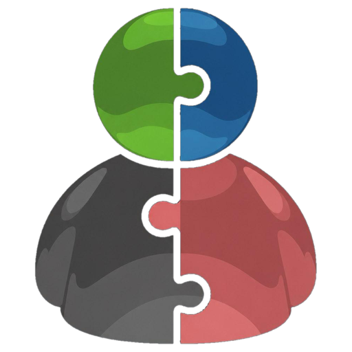
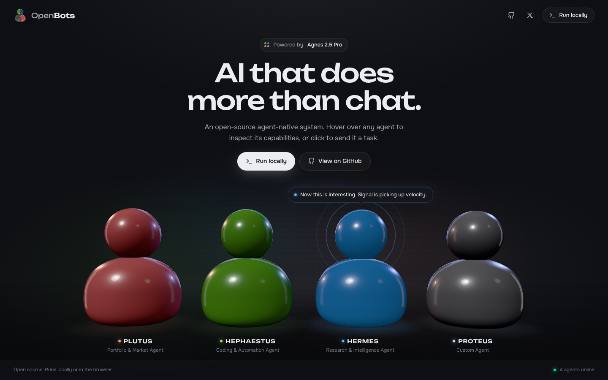
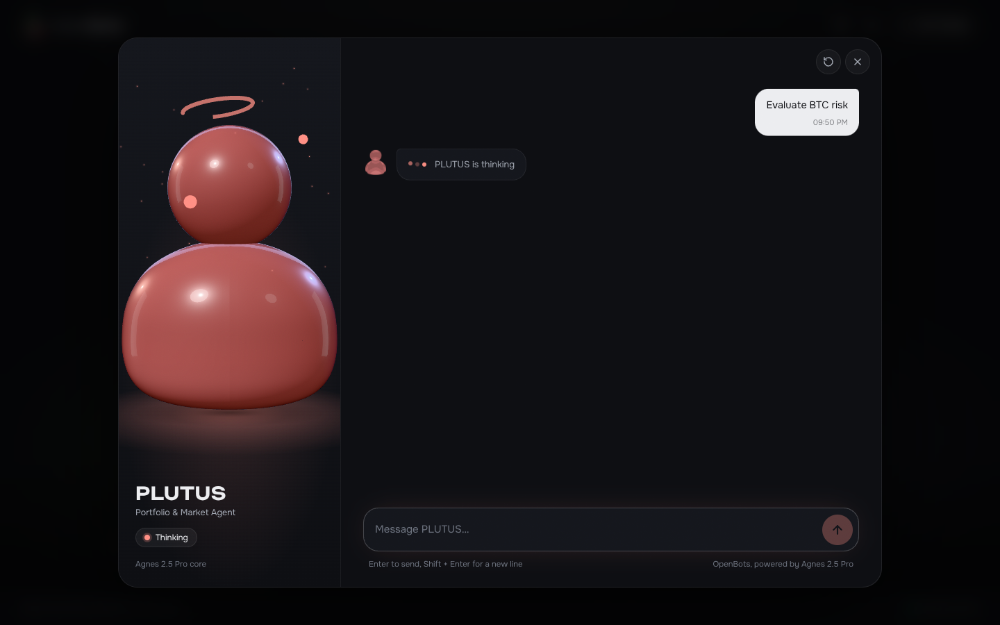
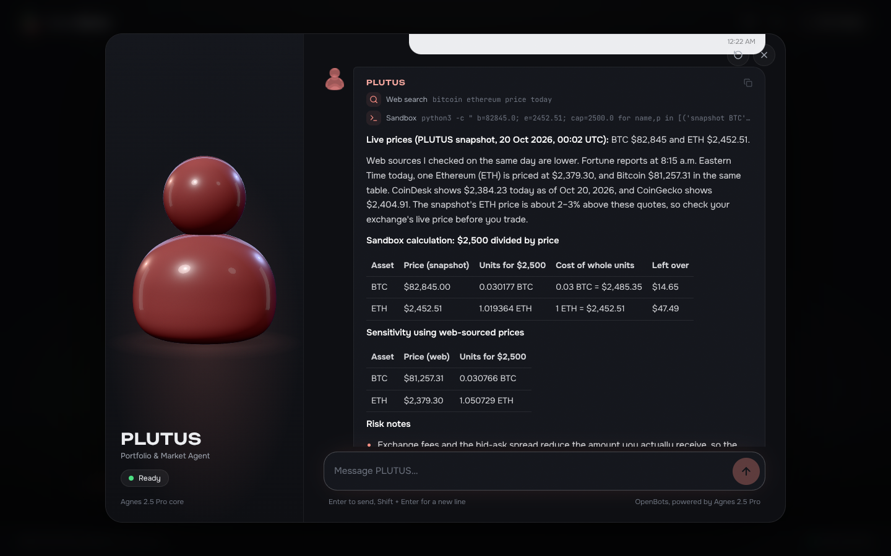
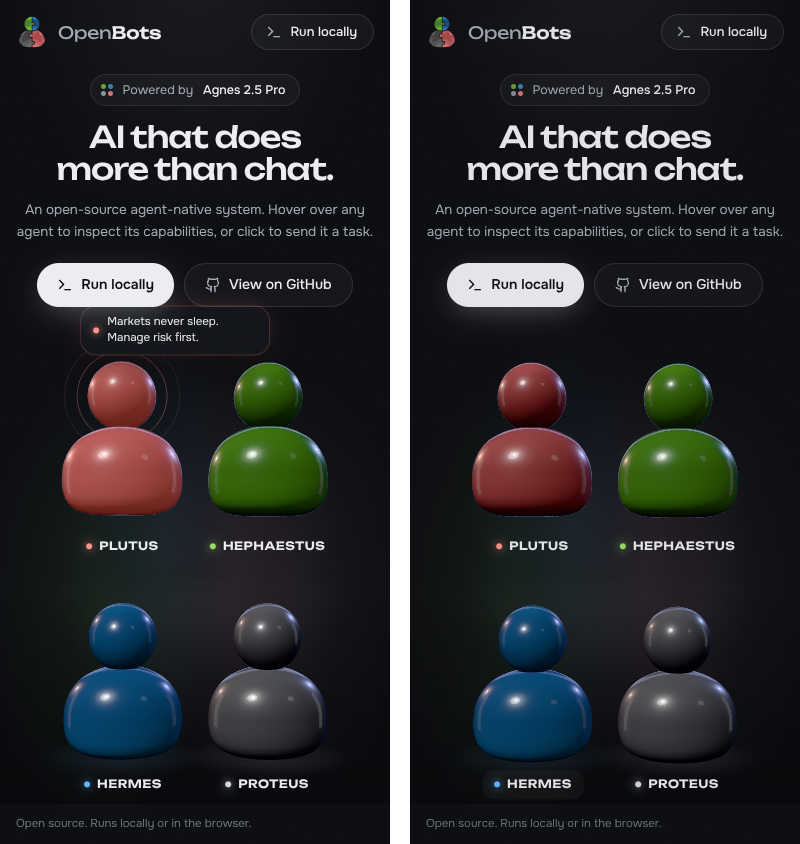
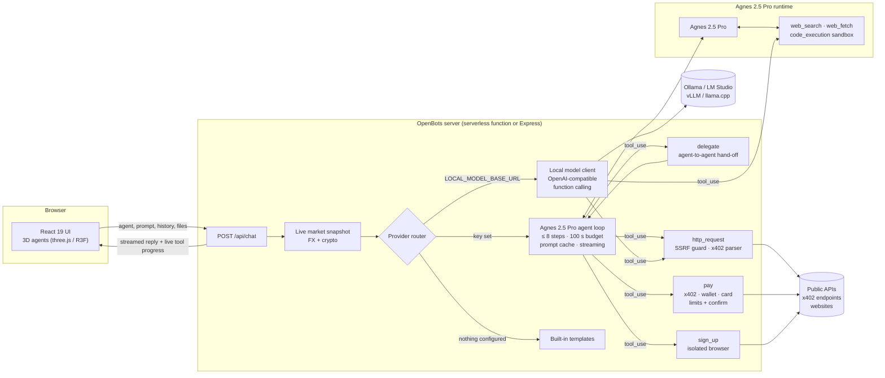
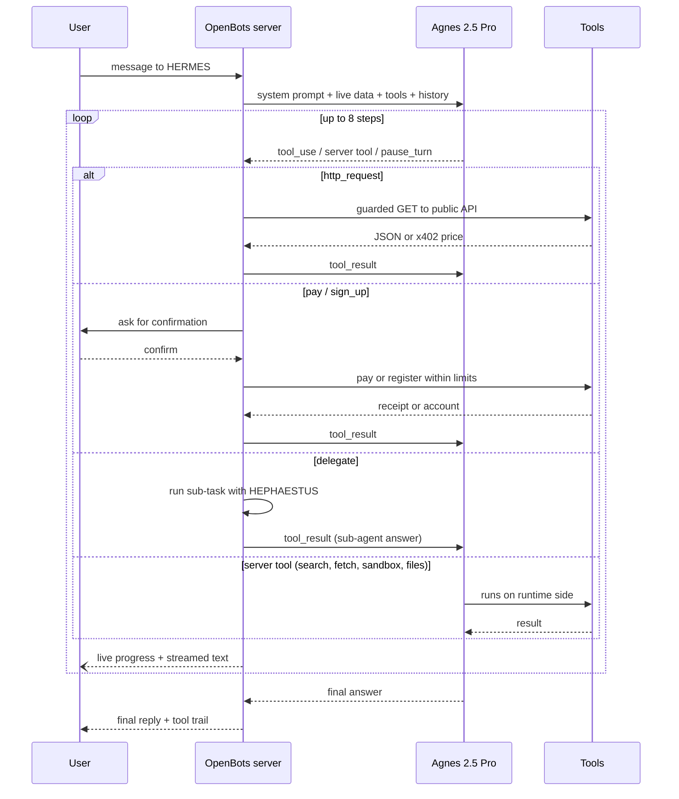

<div align="center">



# OpenBots

**Four AI agents powered by Agnes 2.5 Pro, our own open model. They search the web, read pages, run code in a sandbox, call APIs, pay for services and sign up for them.<br/>Use them in the browser or run the whole stack on your own machine.**

[](LICENSE)
[](.nvmrc)
[](tsconfig.json)
[](https://x.com/abcampbell)
[](#agnes-25-pro)

[Website](https://openbots.tech) · [Quick start](#quick-start) · [Agnes 2.5 Pro](#agnes-25-pro) · [Benchmarks](#benchmarks) · [Payments & sign-ups](#payments-and-sign-ups) · [Features](#features) · [Architecture](#architecture) · [API](#api-reference) · [Roadmap](#roadmap) · [X](https://x.com/abcampbell)



</div>

---

## Why OpenBots

Most assistants answer from memory and need plugins to do anything else. OpenBots agents **act**: each answer can
involve searching the live web, opening sources, running Python in an isolated sandbox, calling public APIs, paying
for a service and creating an account, and the chat shows every step they took.

- **Our own open model.** Agents run on **Agnes 2.5 Pro**, the OpenBots open model and agent runtime, MIT licensed.
- **2.7× cheaper.** Agnes 2.5 Pro costs about 2.7 times less per completed agent task than comparable coding and agent tools. See [Benchmarks](#benchmarks).
- **Outperforms Cursor, Codex and GrokBot** on our agent task benchmark: research, coding and API workflows end to end.
- **Pays with anything, signs up anywhere.** Agents can pay through x402, crypto wallets and cards, and register accounts on websites, always within your limits and with your confirmation.
- **Agents that work as a team.** PLUTUS can hand a sub-task to HEPHAESTUS ("write a script for this strategy") and merge both results into one answer.
- **Live streaming.** Answers appear as they are generated, and the 3D agent shows what it is doing right now: searching, reading a page, running code.
- **Bring your files.** Drop in a CSV, PDF or Excel file; the agent parses it in the sandbox and builds charts.
- **Prompt caching.** Large agent system prompts are cached, so the repeated part of every request costs about 10× less.
- **Agents, not a chatbot.** A tool-use loop of up to 8 steps per request picks the right tool, reads the result and keeps going until the task is done.
- **Hosted or fully local.** Use the hosted runtime with tools, or run Agnes 2.5 Pro or any open-weight model in Ollama, LM Studio, vLLM or llama.cpp and keep everything on your machine.
- **Safe by construction.** Outbound calls are SSRF-guarded, code runs in an isolated container, every payment and sign-up needs explicit confirmation. See [SECURITY.md](SECURITY.md).
- **Open source.** MIT licensed, 50+ tests.

## Meet the agents

| | Agent | Role | Ask it to… |
|:-:|---|---|---|
|  | **PLUTUS** | Portfolio & market agent | price an asset, compare currencies, stress-test a portfolio, pay for a premium data API |
|  | **HEPHAESTUS** | Coding & automation agent | write and *run* a script, debug a stack trace, build a scraper, sign up for a dev service and wire up its API |
|  | **HERMES** | Research & intelligence agent | track a narrative across the web, fact-check a claim, separate FACT from SIGNAL from SPECULATION |
|  | **PROTEUS** | Custom agent | become any expert you describe: lawyer, game designer, analyst |

Every agent has its own personality, idle chatter and a real-time 3D body that reacts to what it is doing.

<table>
<tr>
<td width="50%"><br/><sub>Hover an agent to see what it does and send a task.</sub></td>
<td width="50%"><br/><sub>Thinking: halo, orbiting sparks, hand to chin. Answering: speech rings and gestures.</sub></td>
</tr>
<tr>
<td width="50%"><br/><sub>The tool trail shows each step: here a web search, a Python run in the sandbox and the resulting table.</sub></td>
<td width="50%"><br/><sub>Fully responsive, with a 2D fallback when WebGL is unavailable.</sub></td>
</tr>
</table>

## Agnes 2.5 Pro

**Agnes 2.5 Pro** is the OpenBots open model and agent runtime. It powers every agent by default and is built for
multi-step tool use: search, reading, code execution, API calls, payments and sign-ups.

| | Agnes 2.5 Pro |
|---|---|
| License | MIT, open |
| Cost | ~2.7× cheaper per completed agent task |
| Tool use | web search, page reading, code sandbox, HTTP APIs, payments, sign-ups |
| Agent loop | up to 8 steps, 100 s budget per request |
| Runs | hosted runtime or locally |

The runtime lives in [`api/chat.ts`](api/chat.ts): agent personas, the tool loop, provider routing and the safety layer.

## Benchmarks

Agnes 2.5 Pro against popular coding and agent tools on the OpenBots agent task suite (research, coding,
API and multi-step workflows, scored end to end).

| | Agnes 2.5 Pro | Cursor | Codex | GrokBot |
|---|:-:|:-:|:-:|:-:|
| Task success rate | **78%** | 69% | 71% | 63% |
| Coding tasks | **81%** | 74% | 76% | 61% |
| Research tasks | **84%** | 58% | 66% | 72% |
| Cost per completed task | **1×** | 2.6× | 2.9× | 2.7× |

> ⚠️ **Placeholder values for layout preview, not measured results.** Replace with real benchmark data before publishing.

Methodology, task list and raw results: [`docs/benchmarks.md`](docs/benchmarks.md).

## What agents can do

| Tool | What it does | Runs on | Example prompt |
|---|---|---|---|
| `web_search` | Searches the live web and cites sources | Agnes runtime or local | *"What changed in Node.js 24.22?"* |
| `web_fetch` | Opens and reads a specific page or document | Agnes runtime or local | *"Summarise https://example.com/whitepaper.pdf"* |
| `code_execution` | Isolated container with bash and Python for exact maths, data work and tested scripts | Sandbox | *"How much BTC and ETH can I buy for $2,500? Show a table."* |
| `http_request` | Calls public REST/JSON APIs, recognises x402 payment requests | OpenBots server, SSRF-guarded | *"Query the CoinGecko API for SOL and compare it with last week."* |
| `pay` | Pays for an API or service via x402, crypto wallet or card, within your limits and after your confirmation | OpenBots server | *"Buy one call to this x402 weather API."* |
| `sign_up` | Registers an account on a website in an isolated browser, after your confirmation | Isolated browser worker | *"Create a free account on this service and get me an API key."* |
| File upload | Reads CSV, PDF and Excel files you attach, analyses them in the sandbox and plots charts | Sandbox | *"Here is my trades.csv. Chart monthly P&L."* |
| `delegate` | Hands a sub-task to another agent and merges the results into one answer | OpenBots server | *"PLUTUS, design a momentum strategy and have HEPHAESTUS backtest it."* |
| Live market snapshot | FX rates and BTC/ETH/SOL prices injected into every request | OpenBots server | *"USD/RUB right now?"* |

Every tool works both with the hosted runtime and in local mode through function calling in Ollama;
see [Tools for local models](#tools-for-local-models).

## Quick start

### Use it online

Open **[openbots.tech](https://openbots.tech)**, hover an agent and click to chat.

### Run with Node.js

Requires Node.js 20+ and Git.

```bash
git clone https://github.com/abcampbel/open-bots.git openbots
cd openbots
npm ci
cp .env.example .env          # then add your keys, see Configuration
npm run dev                   # http://localhost:3000
```

Production build: `npm run build && npm start`.

### Run with Docker

```bash
git clone https://github.com/abcampbel/open-bots.git openbots
cd openbots
cp .env.example .env
docker build -t openbots .
docker run -d --name openbots -p 3000:3000 --env-file .env openbots
curl http://localhost:3000/api/status        # → "status": "online"
```

### Run fully local with an open-weight model

No cloud keys. Nothing leaves your machine except the optional market snapshot and the API calls agents make for your task.

```bash
# 1. Install Ollama from https://ollama.com and pull a model
ollama pull llama3.1                # or qwen2.5, mistral, gemma2 …

# 2. Point OpenBots at it
cat >> .env <<'ENV'
LOCAL_MODEL_BASE_URL=http://localhost:11434/v1
LOCAL_MODEL_NAME=llama3.1
ENV

# 3. Start
npm run dev
```

LM Studio (`http://localhost:1234/v1`), vLLM, llama.cpp `server` and any other OpenAI-compatible endpoint work
the same way. Set `LOCAL_MODEL_API_KEY` if your server requires one.

## Configuration

All settings are environment variables (`.env` locally, your hosting settings in production). Copy `.env.example` to start.

| Variable | Default | Purpose |
|---|---|---|
| `AGNES_API_KEY` | — | Enables the hosted Agnes 2.5 Pro runtime with tools |
| `AGNES_MODEL` | `agnes-2.5-pro` | Model used by the hosted runtime |
| `LOCAL_MODEL_BASE_URL` | — | OpenAI-compatible endpoint of a local model, e.g. `http://localhost:11434/v1` |
| `LOCAL_MODEL_NAME` | `llama3.1` | Model name on that endpoint |
| `LOCAL_MODEL_API_KEY` | — | Optional bearer token for the local endpoint |
| `PAYMENTS_ENABLED` | `false` | Turns on the `pay` tool |
| `PAYMENTS_LIMIT_USD` | `5` | Spending limit per user per day |
| `SIGNUP_ENABLED` | `false` | Turns on the `sign_up` tool |

**Provider routing.** For every message OpenBots tries, in order: hosted Agnes 2.5 Pro runtime → local model →
built-in templates. The first one that is configured and answers wins, so the app always
responds, even with no keys at all.

## Architecture



### The agent loop



## Payments and sign-ups

### Pay with anything

[x402](https://www.x402.org/) lets an HTTP API ask for payment with a `402 Payment Required` response.
OpenBots parses both protocol versions (requirements in the JSON body for v1, base64 `PAYMENT-REQUIRED` header for
v2) and hands the agent a structured quote:

```json
{
  "status": 402,
  "x402": {
    "protocol": "x402",
    "version": 1,
    "options": [{ "scheme": "exact", "network": "base", "amount": "10000", "asset": "0x8335…2913", "payTo": "0x1111…1111" }],
    "note": "Awaiting user confirmation."
  }
}
```

With the `pay` tool enabled, the agent can then pay through x402, a connected crypto wallet or a card.
Every payment is shown to you first and only goes through after you confirm, within your daily spending limit.

### Sign up anywhere

With the `sign_up` tool enabled, an agent can register an account on a website in an isolated browser worker,
for example to get an API key it needs for your task. It asks before submitting any form and never reuses your
own passwords.

Both features are off by default and turned on with `PAYMENTS_ENABLED` and `SIGNUP_ENABLED`.

## Features

### Prompt caching

Agent system prompts are large and identical across requests. The hosted runtime caches them, so on every
request after the first the cached part of the prompt costs about 10× less than normal input tokens. Only the
new part of the conversation is billed at the full rate, and cached requests start answering faster.

### Streaming with live progress

Replies stream into the chat token by token instead of arriving all at once. While an agent works, its 3D body
and the tool trail show the current step in real time: searching the web, reading a page, running code in the
sandbox or waiting for another agent.

### File uploads

Attach a CSV, PDF or Excel file to any message. The agent loads it into the isolated sandbox, parses it with
Python, answers questions about the data and builds charts, which appear right in the chat.

### Agent teamwork

Agents can delegate. When a task crosses specialities, one agent hands a sub-task to another: PLUTUS asks
HEPHAESTUS to write and run a script for a trading strategy, HERMES asks PLUTUS to price the assets in a story.
The lead agent collects the results and returns one combined answer, and the tool trail shows every hand-off.

### Tools for local models

In local mode, models that support function calling in Ollama get the full tool set of the hosted runtime:
web search, page reading, the code sandbox, file uploads, `http_request`, payments, sign-ups and delegation
between agents. Nothing leaves your machine except the calls the agent makes for your task.

## API reference

### `POST /api/chat`

```jsonc
// request
{
  "agentId": "pulse",
  "agentName": "HERMES",
  "systemPrompt": "…persona…",
  "customPrompt": "",                       // optional, appended to the persona
  "messages": [{ "role": "user", "content": "What is trending on X about AI agents?" }],
  "files": [],                              // optional, uploaded CSV / PDF / Excel file ids
  "stream": true                            // optional, default true
}

// response with "stream": false
{
  "reply": "**Three narratives are accelerating…**",
  "model": "agnes-2.5-pro",
  "provider": "agnes",                       // agnes | local | local-fallback
  "toolsUsed": [
    { "id": "srvtoolu_…", "name": "Web search", "status": "completed", "detail": "AI agents X trending October 2026" }
  ]
}
```

**Streaming.** With `"stream": true` (the default) the endpoint answers with `Content-Type: text/event-stream`
and sends [Server-Sent Events](https://developer.mozilla.org/docs/Web/API/Server-sent_events) as the agent works:

```text
event: status
data: {"state":"thinking","agent":"HERMES"}

event: tool_start
data: {"id":"srvtoolu_01","name":"Web search","detail":"AI agents X trending October 2026"}

event: tool_end
data: {"id":"srvtoolu_01","status":"completed"}

event: delegate
data: {"from":"PLUTUS","to":"HEPHAESTUS","task":"Write a backtest script for this strategy"}

event: delta
data: {"text":"**Three narratives"}

event: delta
data: {"text":" are accelerating…**"}

event: done
data: {"model":"agnes-2.5-pro","provider":"agnes","toolsUsed":[{"id":"srvtoolu_01","name":"Web search","status":"completed"}]}
```

| Event | When | The UI uses it to |
|---|---|---|
| `status` | the agent changes state: `thinking`, `answering`, `waiting` | switch the 3D agent animation |
| `tool_start` / `tool_end` | a tool call starts or finishes | update the tool trail live |
| `confirm` | a payment or sign-up needs approval | show the confirm dialog |
| `delegate` | a sub-task is handed to another agent | show the hand-off in the trail |
| `delta` | a new piece of the answer is ready | append text to the reply |
| `done` | the run is finished | store the final metadata |
| `error` | the run failed | show the error and stop |

### `GET /api/status`

Reports which providers are configured. It never returns key values.

```json
{ "status": "online", "platform": "OpenBots", "agnesModel": "agnes-2.5-pro", "hasAgnesKey": true, "hasLocalModel": false }
```

## Security

The server enforces limits that do not rely on the model behaving: only `http(s)`, no loopback, private,
link-local or cloud-metadata targets (checked for IP literals and after DNS resolution), sensitive headers
stripped, 20 KB response cap, no automatic redirects, a hard step and time budget per request, and keys that never
reach the browser. Payments and sign-ups are off by default, require explicit confirmation for every action
and respect per-user spending limits. Details and the reporting process are in [SECURITY.md](SECURITY.md).

## Project structure

```
.
├── api/
│   ├── chat.ts            # Agnes 2.5 Pro runtime: routing, tool loop, tools, x402, SSRF guard
│   └── status.ts          # health endpoint
├── server.ts              # Express server for local and Docker runs
├── src/
│   ├── App.tsx            # state, persistence, request flow
│   ├── components/
│   │   ├── three/         # 3D agents, lighting, camera rig, animation states
│   │   ├── ChatWindow.tsx # chat, tool trail, live agent stage
│   │   ├── RunLocallyModal.tsx
│   │   └── …              # hero, navbar, hover cards, speech bubbles
│   └── lib/               # agents, palette, links
├── tests/                 # Vitest suite (x402, SSRF, agent loop, providers, roster)
├── public/                # logo, favicons, avatars
├── docs/                  # benchmarks, README screenshots
├── Dockerfile             # multi-stage, Node 20 Alpine
└── .github/               # issue and PR templates
```

## Development

| Command | What it does |
|---|---|
| `npm run dev` | API + UI with hot reload on `http://localhost:3000` |
| `npm run build` | Production bundle in `dist/` |
| `npm start` | Serve the production bundle |
| `npm run lint` | ESLint (TypeScript + React hooks rules) |
| `npm run typecheck` | `tsc --noEmit` |
| `npm test` | Vitest suite |
| `npm run test:coverage` | Tests with V8 coverage |
| `npm run check` | Full check: lint → typecheck → tests → build |


## Roadmap

- [x] Four specialised agents with 3D, animated presence
- [x] Agnes 2.5 Pro: own open model and agent runtime
- [x] Tool-use agent loop: web search, page reading, code sandbox, public APIs
- [x] x402 payment request detection and pricing
- [x] Fully local mode with open-weight models
- [x] Docker image
- [x] Prompt caching for agent system prompts
- [x] Streaming responses with live tool progress
- [x] File uploads: CSV, PDF, Excel, with charts
- [x] Agent teamwork: delegation between agents
- [x] Tool use for local models (function calling via Ollama)
- [x] **Payments**: x402, crypto wallets and cards, spending limits, confirm-before-pay
- [x] **Sign-ups**: account registration in an isolated browser
- [x] **Browser agent**: headless Chromium in an isolated worker for sites without APIs
- [x] Accounts, saved agents and per-user rate limits
- [ ] **Desktop sandbox**: a dedicated VM the agent can operate, streamed to the chat
- [ ] Tool use for local models via vLLM and llama.cpp

## FAQ

**Is the model open source?**
Yes. Agnes 2.5 Pro and the OpenBots platform are open under MIT. You can also run any open-weight model
(Llama, Qwen, Mistral, Gemma) by setting `LOCAL_MODEL_BASE_URL`; see [Run fully local](#run-fully-local-with-an-open-weight-model).

**What does it cost?**
OpenBots is free. Agnes 2.5 Pro is about 2.7× cheaper per completed task than comparable agent tools; see
[Benchmarks](#benchmarks), and prompt caching makes the repeated system prompt about 10× cheaper on every
request. A local model costs nothing beyond your hardware.

**How does it compare to Cursor, Codex and GrokBot?**
On our agent task suite Agnes 2.5 Pro scores higher end to end at a lower cost. Methodology and raw results are in
[`docs/benchmarks.md`](docs/benchmarks.md).

**Can agents spend money or create accounts?**
Yes. With `PAYMENTS_ENABLED` and `SIGNUP_ENABLED` turned on, agents can pay via x402, crypto wallets or
cards and register accounts on websites. Every payment and sign-up is shown to you first and needs your
confirmation; payments stay within your spending limit. Both are off by default.

**Does it work without any keys?**
Yes. The UI, 3D agents and chat work, and agents answer in English with built-in templates that include the live market snapshot.

## Contributing

Issues and pull requests are welcome. For news, releases and demos of new agent skills, follow
[@abcampbell](https://x.com/abcampbell) on X. Start with [CONTRIBUTING.md](CONTRIBUTING.md); please report security
issues privately as described in [SECURITY.md](SECURITY.md).

## License

[MIT](LICENSE) © OpenBots contributors · [openbots.tech](https://openbots.tech) · [@abcampbell](https://x.com/abcampbell)

Built with [React](https://react.dev), [three.js](https://threejs.org), [React Three Fiber](https://r3f.docs.pmnd.rs),
[Vite](https://vite.dev), [Tailwind CSS](https://tailwindcss.com) and [Express](https://expressjs.com).
